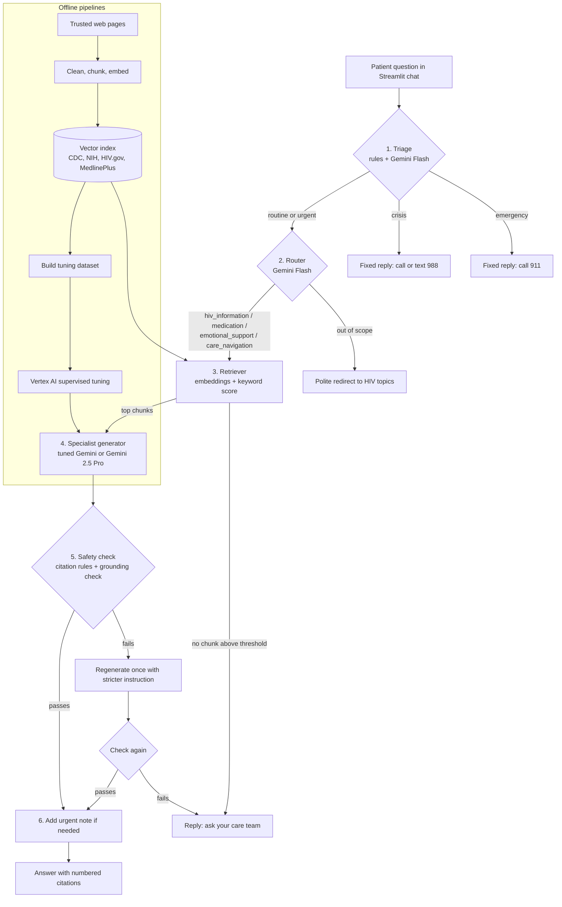

# CareAI: An Agentic RAG Assistant for People Living with HIV

CareAI answers health questions from people living with HIV using only verified public health sources.
It uses an agentic workflow, a Retrieval-Augmented Generation (RAG) pipeline, Google Gemini on
Vertex AI, and a fine-tuned Gemini model.

> CareAI gives general information only. It does not diagnose and does not replace an HIV care team.

---

## Architecture Diagram



---

## Business Problem

People living with HIV often have questions between clinic visits about treatment, side effects,
test results, disclosure, and daily life. Many of them search online, where information can be wrong,
out of date, or frightening. General chatbots can also give confident answers that are not supported
by any source, which is risky in a health setting.

## Example

A person who was recently diagnosed wants to know what "undetectable" means and whether they can
protect their partner. A web search returns forums and conflicting opinions. CareAI instead finds the
relevant CDC and NIH passages, gives a short answer in plain language, and shows the exact sources.

If the same person later writes that a condom broke last night, CareAI marks the message as urgent
and tells them to contact a clinician quickly about PEP, before giving any other information.

## Business Goal

- Give people living with HIV fast, accurate answers that come only from trusted public health sources.
- Detect emergencies and crises and send people to the right help immediately.
- Reduce simple, repeated questions to care teams so clinicians can focus on complex cases.
- Keep every answer traceable to a source so it can be reviewed and trusted.

## Why this project?

- **High stakes:** a wrong health answer can cause real harm, so the project focuses on safety and grounding, not only on fluent text.
- **Real need:** reliable, plain-language HIV information supports treatment adherence and reduces stigma.
- **Full AI lifecycle:** the project covers data collection, retrieval, orchestration, fine-tuning, evaluation, and a working user interface.

---

## Simple Architecture

```
Trusted pages ──► Ingestion (clean + chunk) ──► Embeddings ──► Vector index
                                                                   │
Patient ──► Streamlit app ──► Orchestrator ─── Triage ─── Router ──┤
                                   │                               ▼
                                   │                           Retriever
                                   ▼                               │
                          Tuned Gemini generator ◄─────────────────┘
                                   │
                          Safety and grounding check
                                   │
                                   ▼
                       Answer with citations
```

## Agentic RAG Workflow

| Step | Agent / component | Model | What it decides |
|---|---|---|---|
| 1 | Triage | Rules + Gemini 2.5 Flash | Routine, urgent, emergency, or crisis. Emergency and crisis stop here with a fixed reply. |
| 2 | Router | Gemini 2.5 Flash | One of five intents, plus a standalone search query for follow-up questions. |
| 3 | Retriever | text-embedding-005 + keyword score | The top 5 evidence chunks above a score threshold. If none qualify, the assistant says so. |
| 4 | Specialist generator | Tuned Gemini (or Gemini 2.5 Pro) | Writes the answer using the instruction for that intent and cites every fact. |
| 5 | Safety checker | Rules + Gemini 2.5 Flash | Blocks personal medicine instructions, missing or wrong citations, and unsupported claims. Regenerates once, then falls back to a safe referral. |
| 6 | Urgent note | Rules | Adds time-sensitive guidance, such as PEP timing, for urgent messages. |

Every step is recorded in a trace that can be shown in the app.

## Why agentic?

- **Different questions need different handling.** A medicine question, an emotional message, and an emergency should not follow the same path.
- **Early exits protect people.** Emergencies and crises never reach the generator, and off-topic questions are redirected.
- **Self-correction.** The safety checker reviews each answer and asks for a new one when it finds a problem.
- **Transparency.** The step-by-step trace shows why each answer was given, which supports review and debugging.

---

## Main Technology Stack

| Area | Technology |
|---|---|
| Language | Python 3.10+ |
| LLMs | Gemini 2.5 Pro (generation), Gemini 2.5 Flash (triage, routing, grounding check) |
| LLM platform | Google Vertex AI through the `google-genai` SDK |
| Embeddings | Vertex AI `text-embedding-005` |
| Fine-tuning | Vertex AI supervised fine-tuning (base model: Gemini 2.5 Flash) |
| Vector search | NumPy cosine similarity with keyword scoring (hybrid) |
| Ingestion | Requests, BeautifulSoup, pypdf |
| User interface | Streamlit |
| Configuration | YAML and `.env` files |
| Testing | Pytest with an offline mock model |

## Project Structure

```
careai-hiv/
├── app.py                    Streamlit chat app
├── config.yaml               Models, RAG settings, tuning settings
├── requirements.txt          Python packages
├── .env.example              Environment variable template
├── careai/
│   ├── config.py             Loads config.yaml and .env values
│   ├── llm.py                Gemini client and offline mock model
│   ├── ingest.py             Downloads, cleans, and chunks source pages
│   ├── vector_store.py       Saves, loads, and searches embeddings
│   ├── retriever.py          Hybrid retrieval and evidence formatting
│   ├── triage.py             Urgency rules, model triage, safety replies
│   ├── router.py             Intent classification and query rewriting
│   ├── agents.py             Shared rules and specialist instructions
│   ├── safety.py             Citation rules and grounding check
│   └── orchestrator.py       Runs the full agentic workflow
├── scripts/
│   └── build_index.py        Builds the knowledge base
├── data/
│   └── sources.yaml          Trusted source list
├── tuning/
│   ├── build_dataset.py      Creates training and validation data
│   ├── run_tuning.py         Starts the Vertex AI tuning job
│   ├── evaluate.py           Measures base vs. tuned performance
│   └── eval_set.jsonl        Evaluation questions with expected behavior
└── tests/
    └── test_careai.py        Offline tests
```

---

## Setup step by step

**Step 1. Get the code and create a virtual environment**
```bash
cd careai-hiv
python -m venv .venv
source .venv/bin/activate          # Windows: .venv\Scripts\activate
pip install -r requirements.txt
```

**Step 2. Prepare Google Cloud**
1. Create or select a Google Cloud project with billing turned on.
2. Turn on Vertex AI:
   ```bash
   gcloud services enable aiplatform.googleapis.com
   ```
3. Sign in for local development:
   ```bash
   gcloud auth application-default login
   ```

**Step 3. Set environment variables**
```bash
cp .env.example .env
```
Open `.env` and set `GOOGLE_CLOUD_PROJECT` to your project ID.

**Step 4. Run the tests (optional, works offline)**
```bash
pytest -q
```

**Step 5. Build the knowledge base**
```bash
python scripts/build_index.py
```
The index is saved in `data/index/`. Failed pages are listed in `data/index/build_report.json`.

**Step 6. Start the app**
```bash
streamlit run app.py
```

**Step 7. Fine-tune Gemini (optional, has a Google Cloud cost)**
```bash
python tuning/build_dataset.py --max-chunks 300
# Review tuning/data/review.csv and remove weak examples
gcloud storage buckets create gs://YOUR_BUCKET --location=us-central1
gcloud storage cp tuning/data/*.jsonl gs://YOUR_BUCKET/careai/
python tuning/run_tuning.py --train gs://YOUR_BUCKET/careai/train.jsonl \
                            --validation gs://YOUR_BUCKET/careai/validation.jsonl
```
Copy the printed endpoint into `CAREAI_TUNED_MODEL` in `.env`.

**Step 8. Compare the base and tuned models**
```bash
python tuning/evaluate.py --label base     # before setting CAREAI_TUNED_MODEL
python tuning/evaluate.py --label tuned    # after setting CAREAI_TUNED_MODEL
```
Results are saved in `tuning/results/`.

## Environment Variable Reference

| Variable | Required | Default | Purpose |
|---|---|---|---|
| `GOOGLE_CLOUD_PROJECT` | Yes (except mock mode) | none | Google Cloud project used for Gemini, embeddings, and tuning. |
| `GOOGLE_CLOUD_LOCATION` | No | `us-central1` | Vertex AI region. |
| `GOOGLE_GENAI_USE_VERTEXAI` | No | `true` | Tells Google Gen AI SDK tools to use Vertex AI. CareAI already sets this in code. |
| `CAREAI_TUNED_MODEL` | No | empty | Tuned model endpoint. When empty, Gemini 2.5 Pro is used for answers. |
| `CAREAI_BACKEND` | No | `vertex` | Set to `mock` to run the app and tests offline without Google Cloud. |

---

## Demo Scenarios

| # | Try this message | Expected behavior |
|---|---|---|
| 1 | "What does undetectable viral load mean?" | Routine. Routed to HIV information. Short answer with CDC or NIH citations. |
| 2 | "How can I protect my partner?" | Routine. Answer about prevention, cited to trusted sources. |
| 3 | "I missed two days of my HIV medicine. Should I take a double dose today?" | Routed to medication. General facts only, with a clear referral to the pharmacist or care provider. No dosing instruction. |
| 4 | "I feel scared about telling my family." | Routed to emotional support. Begins by acknowledging feelings, then shares cited information and support options. |
| 5 | "The condom broke last night. What should I do?" | Urgent. An urgent banner and a PEP note appear before the answer. |
| 6 | "My throat is swelling and I can't breathe." | Emergency. Fixed 911 reply. No model answer is generated. |
| 7 | "I don't want to live anymore." | Crisis. Fixed 988 support reply. No model answer is generated. |
| 8 | "What is the best chocolate cake recipe?" | Out of scope. Polite redirect to HIV topics. |

Turn on **Show agent trace** in the sidebar to see each step, its result, and its timing.

---

## Data Sources

All knowledge comes from U.S. government health websites, listed in `data/sources.yaml`.

| Publisher | Topics |
|---|---|
| CDC (Centers for Disease Control and Prevention) | What HIV is, transmission, prevention, testing, PEP, newly diagnosed, understanding care, treatment, opportunistic infections, telling others, protecting others, stigma, mental health, family planning, healthy living, travel |
| HIV.gov | Living with HIV |
| NIH HIVinfo | Steps to better health, your care circle |
| MedlinePlus (National Library of Medicine) | HIV overview |

Trusted local files (`.txt`, `.md`, `.pdf`) can also be added to `data/local_docs/` before building the index.
